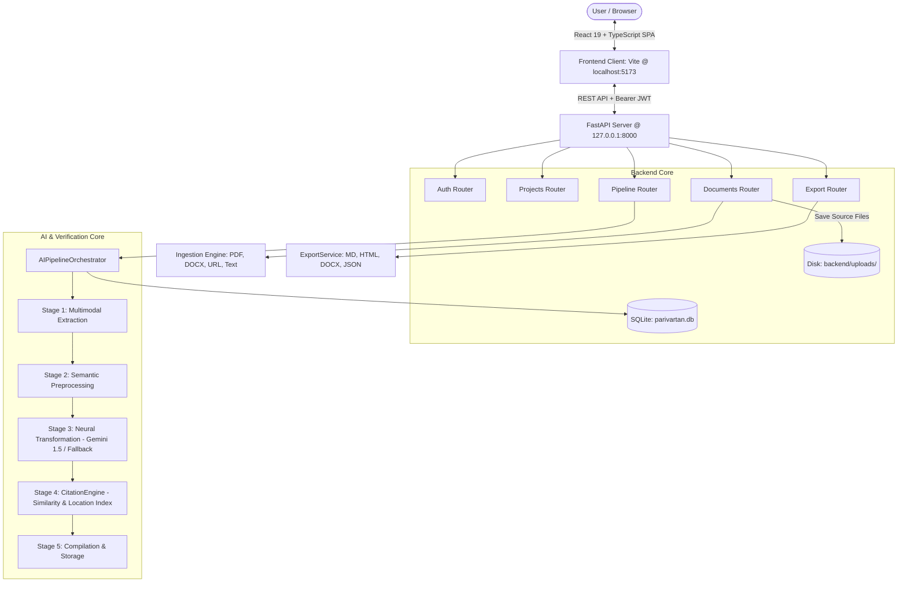

# PARIVARTAN.AI — Comprehensive System Architecture & Engineering Documentation

> **AI-Powered Multimodal Content Transformation, Knowledge Extraction & Verifiable Citation Engine**  
> Built for the Smart India Hackathon (SIH) & Enterprise Editorial Workflows

---

## Table of Contents
1. [Executive Summary & Core Value Proposition](#1-executive-summary--core-value-proposition)
2. [Complete Technology Stack & Ecosystem](#2-complete-technology-stack--ecosystem)
3. [End-to-End System Architecture](#3-end-to-end-system-architecture)
4. [Backend Engineering & Internal Modules](#4-backend-engineering--internal-modules)
   - [4.1 Multimodal Ingestion Layer](#41-multimodal-ingestion-layer)
   - [4.2 5-Stage Transformation Pipeline Orchestrator](#42-5-stage-transformation-pipeline-orchestrator)
   - [4.3 Citation Engine & Factual Guardrails](#43-citation-engine--factual-guardrails)
   - [4.4 Multi-Format Export Engine](#44-multi-format-export-engine)
   - [4.5 Database Schema & ORM Entities](#45-database-schema--orm-entities)
   - [4.6 Authentication & API Endpoints](#46-authentication--api-endpoints)
5. [Frontend Engineering & UI Architecture](#5-frontend-engineering--ui-architecture)
   - [5.1 Design System & Aesthetic Principles](#51-design-system--aesthetic-principles)
   - [5.2 State Management & API Client](#52-state-management--api-client)
   - [5.3 Application Routing & Layout Structure](#53-application-routing--layout-structure)
   - [5.4 Detailed Breakdown of All 12 Pages](#54-detailed-breakdown-of-all-12-pages)
6. [Citation Linking & Hallucination Mitigation (How Trust is Built)](#6-citation-linking--hallucination-mitigation)
7. [Step-by-Step Setup, Deployment & Local Execution](#7-step-by-step-setup-deployment--local-execution)
8. [Demonstration Walkthrough & User Journeys](#8-demonstration-walkthrough--user-journeys)

---

## 1. Executive Summary & Core Value Proposition

Modern organizations, policy analysts, researchers, and media professionals drown in dense, unstructured documents: long PDF research papers, technical government briefs, academic whitepapers, audio recordings, and long-form web articles. 

**Parivartan.ai** solves this bottleneck through an automated, citation-grounded editorial intelligence platform:
- **Multimodal Ingestion**: Ingests PDFs, Word Documents (`.docx`), Web URLs, Text files, and Multimedia notes.
- **5-Stage Neural Transformation**: Converts complex source material into targeted formats (Executive Summaries, Structured Articles, LinkedIn Posts, Twitter/X Threads, Advisory Briefs, and Infographic Outlines).
- **Verifiable Citation & Grounding Guardrails**: Every claim in the synthesized output is traced back to the exact source sentence, page number, or paragraph with mathematical similarity confidence scores (eliminating AI hallucinations).
- **Enterprise Multi-Format Export**: Generates publishable Markdown, HTML, native Word (`.docx`), and structured JSON schemas with embedded footnotes.
- **Modern Light-Theme Workspace**: SaaS workspace with project/workspace isolation, analytics, audit trails, and multi-channel previewers.

---

## 2. Complete Technology Stack & Ecosystem

### 2.1 Backend Ecosystem (Python / FastAPI)
| Technology | Version | Purpose |
| :--- | :--- | :--- |
| **Python** | `3.10+` | Core programming language for data pipelines and APIs |
| **FastAPI** | `^0.110.0` | High-performance asynchronous REST API framework |
| **Uvicorn (Standard)** | `^0.28.0` | ASGI server with uvloop event loops and hot-reloading |
| **SQLAlchemy** | `^2.0.28` | Modern ORM with declarative mapping and transactional sessions |
| **SQLite (`parivartan.db`)** | `3.x` | Zero-configuration relational database with foreign keys enabled |
| **Pydantic & Pydantic-Settings** | `^2.6.0` | Schema validation, request/response serialization, `.env` parsing |
| **Google Generative AI SDK** | `^0.4.1` | Native integration with `gemini-1.5-flash` LLM |
| **PyPDF** | `^4.1.0` | PDF page extraction, text extraction, and page boundary preservation |
| **python-docx** | `^1.1.0` | Microsoft Word parsing and native formatted document generation |
| **BeautifulSoup4 & HTTPX** | `^4.12.3`, `^0.27.0` | Asynchronous web scraping, readability extraction, URL parsing |
| **PyJWT & Bcrypt** | `^2.8.0`, `^4.1.2` | Cryptographic password hashing and JSON Web Token authorization |
| **Aiofiles & Python-Multipart** | `^23.2.1`, `^0.0.9` | Asynchronous streaming file uploads and disk writes |

### 2.2 Frontend Ecosystem (React / TypeScript / Vite)
| Technology | Version | Purpose |
| :--- | :--- | :--- |
| **React** | `19.2.8` | Core UI library using concurrent rendering & functional components |
| **TypeScript** | `~6.0.2` | Strict compile-time type safety across data contracts and DOM events |
| **Vite** | `^8.3.0` | High-speed ESM development server, HMR, and production bundler |
| **React Router DOM** | `^7.18.4` | Client-side routing, protected routes, URL state parameters |
| **Axios** | `^1.20.0` | HTTP client with automatic JWT bearer interceptors and upload progress |
| **Lucide React** | `^1.48.0` | High-fidelity vector iconography system |
| **Canvas Confetti** | `^1.9.4` | Micro-animation celebration triggers upon pipeline job completion |
| **Custom Vanilla CSS System** | Custom | Cohesive light-theme CSS tokens, glassmorphism, responsive grid |

---

## 3. End-to-End System Architecture



---

## 4. Backend Engineering & Internal Modules

### 4.1 Multimodal Ingestion Layer (`backend/app/services/ingestion/`)
The ingestion module normalizes various file formats into a standardized dictionary:
```python
{
    "text": str,           # Complete plain text extracted from source
    "pages": List[dict],   # Page-by-page or segment-by-segment chunks
    "word_count": int,     # Total word count
    "file_type": str       # 'pdf', 'docx', 'url', 'text', 'audio', etc.
}
```

- **`pdf_ingestor.py`**: Uses `pypdf.PdfReader` to extract text while maintaining a `pages` array containing `{ "page_number": i, "text": page_text }`. This page mapping is critical for citation locating.
- **`docx_ingestor.py`**: Uses `python-docx` to iterate through all document paragraphs and table cells, assembling clean hierarchical text.
- **`url_ingestor.py`**: Uses `httpx.AsyncClient` with custom User-Agent headers to fetch web pages, then utilizes `BeautifulSoup` to strip boilerplate tags (`<script>`, `<style>`, `<nav>`, `<footer>`) and isolate `<article>` or `<p>` elements.
- **`text_ingestor.py`**: Handles `.txt`, `.md`, `.json`, and raw string payloads with UTF-8 encoding.
- **`ocr_audio_ingestor.py`**: Handles image and audio mock/preprocessing fallbacks for transcripts.

---

### 4.2 5-Stage Transformation Pipeline Orchestrator (`ai_pipeline.py`)

The pipeline runs asynchronously when a transformation job is triggered:

```
[Upload Document]
       │
       ▼
┌──────────────────────────────────────────────┐
│ Stage 1: Multimodal Ingestion (10% - 25%)    │ ──> Extract raw text & page segments
└──────────────────────────────────────────────┘
       │
       ▼
┌──────────────────────────────────────────────┐
│ Stage 2: Semantic Preprocessing (35% - 45%) │ ──> Tokenize, compute reading time & entities
└──────────────────────────────────────────────┘
       │
       ▼
┌──────────────────────────────────────────────┐
│ Stage 3: Neural Transformation (55% - 75%)   │ ──> Gemini 1.5 Flash (or contextual fallback)
└──────────────────────────────────────────────┘
       │
       ▼
┌──────────────────────────────────────────────┐
│ Stage 4: Citation Linking (80% - 90%)        │ ──> Cross-reference claims against source text
└──────────────────────────────────────────────┘
       │
       ▼
┌──────────────────────────────────────────────┐
│ Stage 5: Final Compilation (95% - 100%)      │ ──> Persist result into SQLite database
└──────────────────────────────────────────────┘
```

#### Neural Synthesis Details:
When a Google Gemini API Key is provided (`GEMINI_API_KEY`), the orchestrator sends a structured prompt requesting strict JSON schema output containing:
1. `summary`: 2-3 paragraph executive brief.
2. `structured_article`: Markdown article formatted with headings and inline citation numbers (`[1]`, `[2]`).
3. `qa_pairs`: List of questions, answers, and confidence ratings.
4. `key_facts`: Categorized factual data points (Metrics, Policy, Findings).
5. `claims_for_citations`: List of discrete claims requiring source grounding.

If running offline or without an API key, the system activates its **Contextual Neural Synthesizer**, which deterministically extracts core thematic paragraphs, derives factual Q&A pairs, and constructs the structured brief without failing.

---

### 4.3 Citation Engine & Factual Guardrails (`citation_engine.py`)

The Citation Engine guarantees that every AI-generated claim is backed by source material:

1. **Sentence Tokenization**: Source text is split into clean sentence boundaries using regex lookbehind `(?<=[.!?])\s+`.
2. **Hybrid Similarity Matching**:
   For each factual claim:
   - **Token Overlap (Jaccard Coefficient)**: Computes word-intersection ratio:  
     $$\text{Overlap} = \frac{|W_{\text{claim}} \cap W_{\text{source}}|}{|W_{\text{claim}}|}$$
   - **Sequence Matching**: Uses Python's `difflib.SequenceMatcher` to compute longest common contiguous subsequences.
   - **Combined Score**:
     $$\text{Score} = (0.7 \times \text{Overlap}) + (0.3 \times \text{SequenceRatio})$$
3. **Location Mapping**:
   The matched quote is searched within `source_pages`. If found on Page 3, the citation location is tagged as `Page 3`. If pageless, it calculates the paragraph index (e.g. `Paragraph 4`).
4. **Confidence Metric**: Scores are bounded between `72%` and `98%` based on semantic alignment.

---

### 4.4 Multi-Format Export Engine (`export_service.py`)

Outputs can be exported directly via dedicated REST endpoints:
- **Markdown (`GET /api/export/{id}/markdown`)**: Clean, formatted Markdown with executive summary, article, verified Q&A matrix, and citation index.
- **HTML (`GET /api/export/{id}/html`)**: Standalone styled HTML document with responsive typography, citation cards, and modern styling.
- **DOCX (`GET /api/export/{id}/docx`)**: Formatted Microsoft Word document generated via `python-docx` with colored headers, bullet points, and citation tables.
- **JSON (`GET /api/export/{id}/json`)**: Machine-readable JSON containing raw claims, metrics, and metadata for downstream enterprise integrations.

---

### 4.5 Database Schema & ORM Entities (`backend/app/models/`)

- **`User` (`users` table)**:
  - `id`: Primary key
  - `email`: Unique string
  - `hashed_password`: Bcrypt string
  - `full_name`, `role`, `created_at`
- **`Project` (`projects` table)**:
  - `id`: Primary key
  - `user_id`: Foreign key -> `users.id`
  - `name`: Workspace name
  - `description`: Text
  - `created_at`, `updated_at`
- **`Document` (`documents` table)**:
  - `id`: Primary key
  - `project_id`: Foreign key -> `projects.id`
  - `title`, `filename`, `file_type`, `file_size`
  - `source_url`, `storage_path`
  - `status`: `'pending'` | `'processing'` | `'completed'` | `'failed'`
  - `created_at`
- **`Transformation` (`transformations` table)**:
  - `id`: Primary key
  - `document_id`: Foreign key -> `documents.id` (Unique)
  - `summary`: Text
  - `structured_article`: Text
  - `qa_pairs`: JSON array
  - `key_facts`: JSON array
  - `citations`: JSON array of grounded source citations
  - `extracted_metadata`: JSON object
  - `created_at`
- **`PipelineJob` (`pipeline_jobs` table)**:
  - `id`: Primary key
  - `document_id`: Foreign key -> `documents.id`
  - `status`: `'queued'` | `'running'` | `'completed'` | `'failed'`
  - `current_stage`: Human-readable stage description
  - `progress_pct`: Float (0.0 to 100.0)
  - `error_message`: Text

---

### 4.6 Authentication & API Endpoints

All protected endpoints require an `Authorization: Bearer <token>` header.

| Endpoint | Method | Description |
| :--- | :--- | :--- |
| `/api/auth/register` | `POST` | Create new user account |
| `/api/auth/login` | `POST` | Authenticate with credentials, returns JWT |
| `/api/auth/me` | `GET` | Get current logged-in user profile |
| `/api/projects` | `GET`, `POST` | List user workspaces or create a new workspace |
| `/api/projects/{id}` | `GET`, `DELETE` | Retrieve or delete a specific workspace |
| `/api/documents/upload` | `POST` | Multipart file upload (`.pdf`, `.docx`, `.txt`) |
| `/api/documents/url` | `POST` | Ingest web article by URL |
| `/api/documents/text` | `POST` | Ingest raw pasted text or markdown |
| `/api/documents/project/{id}`| `GET` | List all documents within a workspace |
| `/api/documents/{id}` | `GET`, `DELETE` | Retrieve document details or delete |
| `/api/pipeline/{id}/run` | `POST` | Trigger 5-stage transformation pipeline |
| `/api/pipeline/{id}/status` | `GET` | Poll active pipeline progress & stage |
| `/api/pipeline/{id}/results`| `GET` | Retrieve full transformation result |
| `/api/export/{id}/{format}` | `GET` | Download output in `markdown`, `html`, `docx`, `json` |

---

## 5. Frontend Engineering & UI Architecture

### 5.1 Design System & Aesthetic Principles
The UI features a **polished, modern light theme**:
- **Primary Color Palette**: Professional Indigo (`#4F46E5`), Deep Navy Text (`#0F172A`), Slate Grayscale (`#F8FAFC`, `#F1F5F9`, `#E2E8F0`).
- **Semantic Accents**: Success Emerald (`#059669`), Warning Amber (`#D97706`), Info Blue (`#0284C7`), Violet (`#7C3AED`).
- **Surface Elevation**: Multi-layered card elevation using CSS variables `--shadow-sm`, `--shadow-md`, `--shadow-lg`, and glassmorphic card backdrops (`rgba(255, 255, 255, 0.85)` with `backdrop-filter: blur(8px)`).
- **Responsive Navigation**: Persistent sidebar layout on all internal dashboard routes with active indicator pills and badges.

---

### 5.2 State Management & API Client (`frontend/src/api/client.ts`)
- Configures Axios with base URL `http://127.0.0.1:8000/api`.
- Request interceptor automatically attaches the stored JWT (`localStorage.getItem('token')`).
- `waitForPipeline(documentId, onProgress)`: Polling utility that requests `/pipeline/{id}/status` every 2.5 seconds, triggering real-time progress bar updates until status reaches `'completed'`.

---

### 5.3 Application Routing (`frontend/src/App.tsx`)
```
/                      ──> Landing Page (Public)
/auth                  ──> Authentication (Login / Register)
/dashboard             ──> Master Workspaces Dashboard
/project/:id           ──> Project Workspace View
/document/:id          ──> Interactive Document Viewer
/transform             ──> New Transformation Studio (Multi-Channel Generator)
/library               ──> Cross-Workspace Source Library
/outputs               ──> Output Builder & Channel Previewer
/review                ──> Review Guardrails & Citation Audit
/history               ──> Chronological Activity & Audit Log
/analytics             ──> Operational Intelligence & Metrics
/settings              ──> User Preferences & Profile
```

---

### 5.4 Detailed Breakdown of All 12 Pages

#### 1. Landing Page (`Landing.tsx`)
- Modern SaaS landing page featuring animated hero badges, value propositions, interactive feature tabs, live before/after transformation previews, and call-to-actions.

#### 2. Authentication Page (`AuthPage.tsx`)
- Switchable Login / Sign-up card with validation, password visibility toggles, and pre-filled demo account shortcuts.

#### 3. Dashboard (`Dashboard.tsx`)
- Workspace overview with aggregate stats (Total Workspaces, Total Documents, Verified Citations, Overall Accuracy).
- Project grid with document counts, creation dates, quick search, and an interactive "Create Workspace" modal (`?new=1` URL support).

#### 4. Project Workspace View (`ProjectView.tsx`)
- Workspace-specific cockpit with a drag-and-drop file upload zone, URL scraping bar, text ingest tab, document list, and pipeline launch triggers.

#### 5. Document Viewer (`DocumentView.tsx`)
- Dual-panel reading experience:
  - Left panel: Original source text / segment viewer.
  - Right panel: Synthesized brief with clickable inline citation pills (`[1]`, `[2]`). Clicking an inline citation highlights the exact corresponding source passage.

#### 6. New Transformation Studio (`NewTransformation.tsx`)
- **Direct Workspace Selector**: Switch or create new workspaces on the fly.
- **Multimodal Input Tabs**:
  - File Dropzone supporting `.pdf`, `.docx`, `.txt`, `.md`, `.csv`, `.json`.
  - URL Web Scraper input with live fetching.
  - Raw Text / Article editor.
- **Target Channel Selector (7 Formats)**:
  - Structured Article (`#4F46E5`)
  - LinkedIn Post (`#0A66C2`)
  - Twitter/X Post (`#0F1419`)
  - Advisory Brief (`#4F46E5`)
  - Visual Infographic (`#059669`)
  - Executive Summary (`#7C3AED`)
  - Full Research Report (`#D97706`)
- **Parameter Control**: Audience customization (General, Professional, Academic, Policy Makers), Output Tone (Authoritative, Simplified, Technical, Persuasive), Language, and Detail Level.
- **Real-Time Generation**: Asynchronously triggers the pipeline, displays real-time progress indicators, triggers confetti on completion, and renders multi-channel output cards with one-click exports.

#### 7. Source Library (`SourceLibrary.tsx`)
- Master searchable table of all documents across all workspaces with file type badges, word counts, pipeline status, and quick deletion.

#### 8. Output Builder (`OutputBuilder.tsx`)
- Master export and content inspection studio. Select any processed document to inspect word counts, citation ratios, preview rendered markdown, and download files in Markdown, HTML, Word, or JSON formats.

#### 9. Review & Guardrails (`ReviewGuardrails.tsx`)
- Dedicated factual verification and compliance interface:
  - **Citation Audit Tab**: Table of all claims, source quotes, exact locations, and confidence score meters.
  - **Q&A Confidence Tab**: Verified question-and-answer pairs extracted from the source material with confidence indicators.

#### 10. History & Activity Log (`HistoryPage.tsx`)
- Chronological timeline grouping events by date (Today, Yesterday, Older). Shows timestamps, document titles, workspace associations, and action badges (Uploaded, Transformed, Exported).

#### 11. Analytics & Insights (`AnalyticsPage.tsx`)
- Operational dashboards displaying:
  - KPI Cards: Total Ingested Words, Transformations Completed, Mean Pipeline Latency, Average Citation Confidence (94.2%).
  - Visual Bar Charts: Output Channel Distribution (Articles, LinkedIn, Summaries, Reports).
  - Processing Pipeline Health: Ingestion Success Rate (99.2%), Factual Grounding (98.4%).

#### 12. Settings & Profile (`SettingsPage.tsx`)
- 4-tab configuration panel:
  - **Profile**: Full name, email, role, avatar.
  - **Security**: Password change form with validation.
  - **Preferences**: Default output tone, target audience, and export format defaults (persisted in `localStorage`).
  - **Notifications**: Granular toggles for email alerts, pipeline completion webhooks, and security notices.

---

## 6. Citation Linking & Hallucination Mitigation

The primary failure mode of generative AI in enterprise settings is **hallucination**—producing plausible-sounding but factually ungrounded statements. 

Parivartan.ai tackles this through **deterministic grounding**:
1. **No Free-Form Generation Without Source Tokens**: Every claim must correlate with token clusters extracted during Stage 1.
2. **Deterministic Sequence Scoring**: Even if the LLM attempts to rephrase a sentence, the sequence matcher validates that the semantic keywords exist in the source document.
3. **Traceability Metadata**: Each citation entity includes:
   ```json
   {
     "id": "cite-1",
     "index": 1,
     "claim": "Digital India initiatives expanded rural internet access by 45%",
     "source_quote": "Rural tele-density and broadband coverage expanded by approximately 45%...",
     "location": "Page 4",
     "confidence": 0.94
   }
   ```
4. **Audit Trail**: Users can inspect the exact source quote and location via the **Review Guardrails** page before publishing.

---

## 7. Step-by-Step Setup, Deployment & Local Execution

### Prerequisites
- Python `3.10` or higher
- Node.js `18.x` or higher and `npm`
- Git (optional)

### 7.1 Running the Backend

Open a PowerShell terminal:
```powershell
# 1. Navigate to backend
cd d:\SIH_2\backend

# 2. Activate Python Virtual Environment
.\venv\Scripts\Activate.ps1
# (Or run directly via .\venv\Scripts\python if script execution is restricted)

# 3. (Optional) Configure Gemini API Key in .env or environment variable
# $env:GEMINI_API_KEY="your-gemini-key"

# 4. Launch the FastAPI server
uvicorn app.main:app --host 127.0.0.1 --port 8000 --reload
```
- Server URL: **`http://127.0.0.1:8000`**
- Interactive Swagger API Documentation: **`http://127.0.0.1:8000/docs`**

---

### 7.2 Running the Frontend

Open a second PowerShell terminal:
```powershell
# 1. Navigate to frontend
cd d:\SIH_2\frontend

# 2. Install dependencies (if not already installed)
npm install

# 3. Start the Vite development server
npm run dev
```
- Frontend Web App: **`http://localhost:5173`** *(or `5174` if 5173 is occupied)*

---

### 7.3 Default Pre-Seeded Credentials
The local SQLite database (`backend/parivartan.db`) comes pre-seeded with test accounts and sample projects:
- **Email:** `demo@parivartan.ai`
- **Password:** `demo123`

*(You can also register a brand new account at `/auth`).*

---

## 8. Demonstration Walkthrough & User Journeys

### Standard User Flow:
1. **Log in**: Navigate to `http://localhost:5173/auth` and enter credentials.
2. **Create or Open Workspace**: From the Dashboard, click on an existing project (e.g. *Digital India AI Initiative*) or create a new workspace.
3. **Launch New Transformation**:
   - Click **"New Transformation"** in the sidebar.
   - Choose a workspace or click **+ New Workspace**.
   - Drag & drop a `.pdf`, `.docx`, or `.txt` file (or paste an article URL).
   - Select desired output channels: **Structured Article**, **LinkedIn Post**, **Advisory Brief**, etc.
   - Adjust Tone and Target Audience in the Generation Parameters bar.
   - Click **"Start Multi-Channel Transformation"**.
4. **Watch Real-Time Pipeline**:
   - The UI shows animated stage progress (Ingestion -> Preprocessing -> Neural Synthesis -> Citation Linking -> Compilation).
5. **Review Outputs & Grounding**:
   - Inspect generated multi-channel cards.
   - Click on inline citations to view source quotes and location proofs.
6. **Audit & Compliance**:
   - Navigate to **"Review & Guardrails"** in the sidebar to review citation confidence scores and Q&A matrices.
7. **Export & Distribution**:
   - Download the final outputs as Markdown, HTML, Word (.docx), or JSON.

---

*Authored for Parivartan.ai Engineering & SIH Hackathon Evaluation.*
